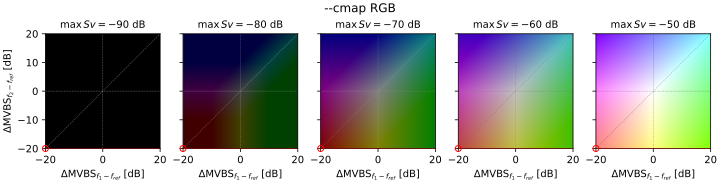
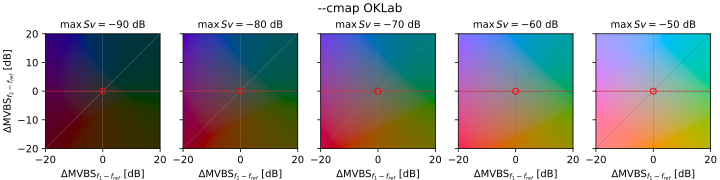

# Fancy multifrequency echograms

This small library provides functions for plotting multifrequency echograms. 

The [`echogram`](src/echograms/echograms.py) function is rather basic and creates a matplotlib figure containing [`QuadMesh`](https://matplotlib.org/stable/api/collections_api.html#matplotlib.collections.QuadMesh) representing multifrequency acoustic data.

The originality of this package is the use of custom multifrequency to RGB `Encoding`'s, which define multifrequency colormaps.

Two `Encoding` are currently implemented, both designed to represent up to three sonar channels:

* `RGB` -  Maps the three frequencies to red, green and blue.
* `OKLab` - Uses the maximum Sv for lightness and the differences between the second and third frequencies and the first (reference) frequency for hue and chroma.

> The motivation for the `OKLab` colormap comes from perceptual limitations of the `RGB`
> representation, which has been used by deep sea ecologists. The goal is to get:
> 
> 1. Perceptually uniform lightness mapped to max(Sv) & independent of ΔSv → L ~ max(Sv) (clipped & rescaled)
> 2. Approx. uniform changes in color when moving in the ΔSv plane → a, b ~ ΔSv(f1), ΔSv(f2)
> 3. Colors roughly matching the `RGB` mode → (a, b) plane is rotated
>
> For more info on the OKLab color space, check [https://bottosson.github.io/posts/oklab/](https://bottosson.github.io/posts/oklab/).



*Multifrequency colormaps available. Red dashed line (resp. red dot) corresponds to the case in which f2 (resp. f2 and f1) is NA, which typically happens in acoustic datasets because of frequency-dependent range limitations.*

## API

```python
import matplotlib.pyplot as plt
import xarray as xr

from echograms import echogram, OKLab

ds_MVBS: xr.Dataset = xr.open_dataset('path/to/data.zarr', engine='zarr')

# select 24-h of Sv data
da_Sv: xr.DataArray = ds_MVBS.Sv.sel(ping_time="2017-09-01")

# plot echogram
fig, ax = plt.subplots(figsize=(20, 6))
_ = echogram(da_Sv, OKLab(), ax=ax)
```
